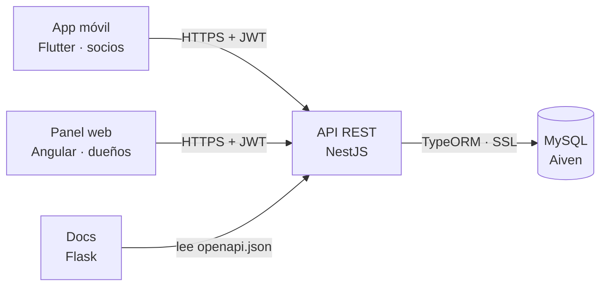

# Arquitectura

Es cliente-servidor: dos clientes hablan con la misma API REST, y la API guarda todo en MySQL.

| Parte | Tecnología | Lenguaje |
|---|---|---|
| Panel web | Angular 18 | TypeScript, HTML, SCSS |
| App móvil | Flutter | Dart |
| API | NestJS 10 sobre Node.js, TypeORM, JWT | TypeScript |
| Base de datos | MySQL 8 | SQL |
| Documentación | Flask 3 | Python |
| Pruebas | Selenium + pytest | Python |
| Contenedores | Docker y Docker Compose | YAML, Dockerfile |

Cada módulo de la API tiene `controller` (recibe la petición), `service` (la lógica),
`dto` (valida los datos) y `module` (los une).
