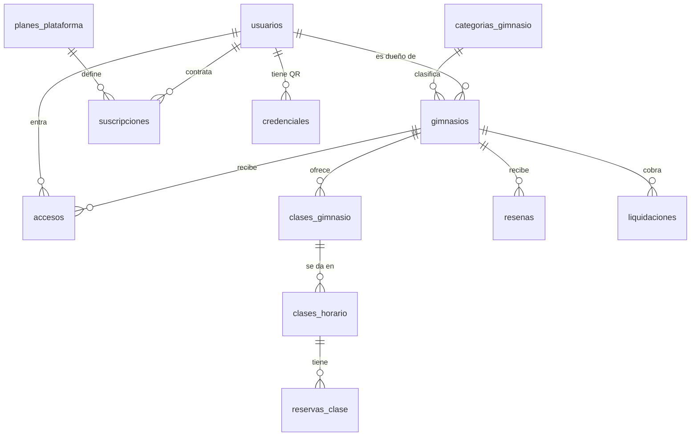

# Base de datos

MySQL 8 con 28 tablas y 2 vistas. Abajo están las relaciones principales; la lista
completa de tablas y columnas se lee de los scripts SQL del repo.

## Migraciones

Cada cambio a la base es un script numerado en `docker/*/mysql/`. Se corren en orden y
todos se pueden correr más de una vez.

| Script | Qué hace |
|---|---|
| 01_schema.sql | Tablas base |
| 02_seed.sql | Datos de prueba |
| 03_catalogo.sql | Catálogos de equipo y amenidades |
| 04_normalizacion.sql | Ajustes de normalización |
| 05_modelo_sin_cuota.sql | Los gimnasios ya no pagan cuota |
| 06_clases_y_resenas.sql | Clases, reservas y reseñas |
| 08_modelo_wellhub.sql | Planes Esencial y Plus, categorías y topes |
| 10_diseno_negro_rojo.sql | Diseño del panel en negro y rojo |
| 11_dias_y_fotos.sql | Modelo por días (Esencial 15, Plus 30), reingresos y fotos en la base |
| 12_seguridad.sql | Bloqueo por intentos y recuperación de contraseña |

Los scripts 07 y 09 solo traen datos de prueba.
